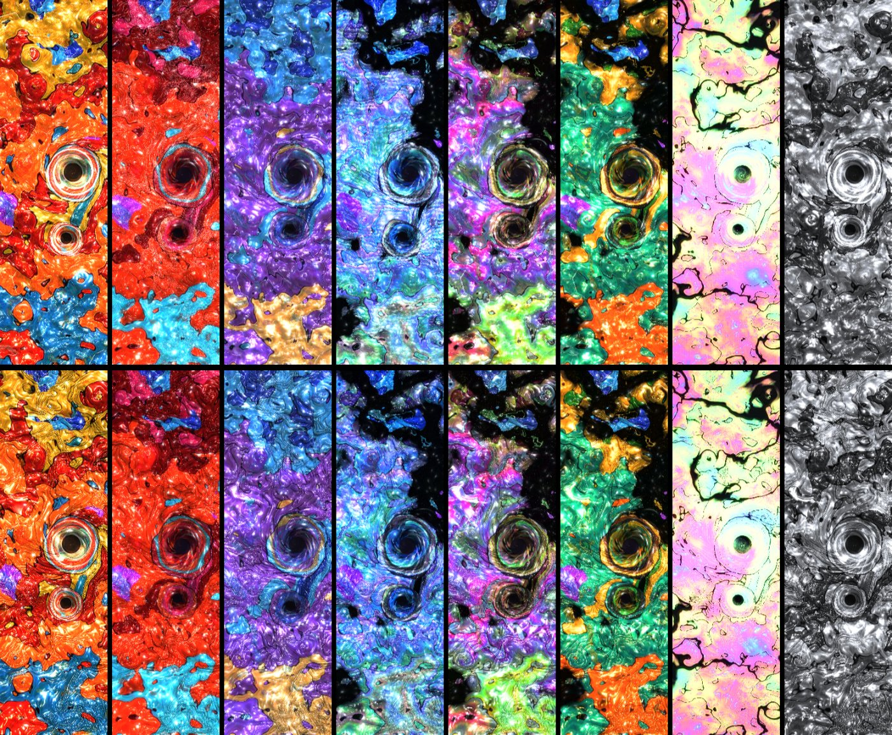
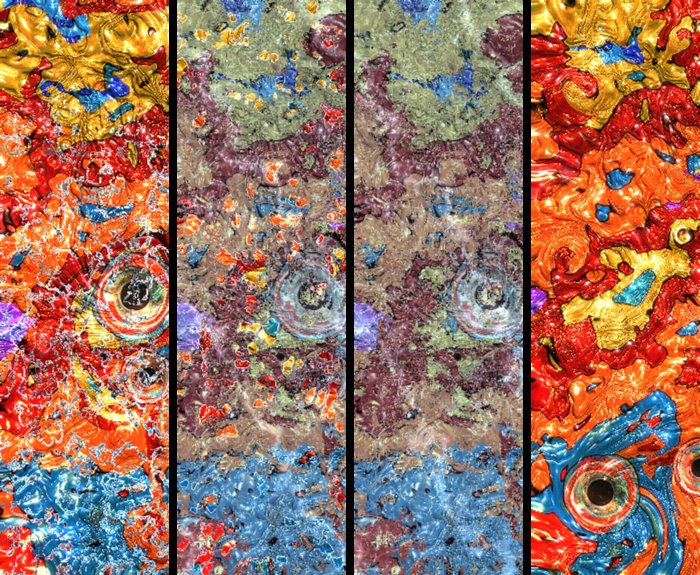

# LIQUID COSMOS — 光の習作

落合陽一氏の作品「リキッドユニバース」の**同人作品（ファンアート）**です。オリジナルではありません。
美術館で見た LED の柱の映像の質感を、ブラウザの WebGL シェーダーで再現しようとした個人の習作で、落合陽一氏および関係者とは一切関係ありません。

**▶ デモ：** https://unnameable-lab.github.io/liquid-cosmos/

## できること

- **8つのシーン**：陽光・紅・宵・螺鈿・虹油・緑金・薄虹・モノクロ、と「移ろい」（自動で巡回）
- **渦**：点渦の物理（ビオ・サバール）で動く2つの渦。触れ合うと半周回って別れる
- **流体の移流**：模様は流れに運ばれ、引き伸ばされ、渦に巻き込まれる
- **液体の質感**：高さの地図から視差・影・照り返しを計算した、とろっとした液面
- **❄ 凍る**：霜が結晶状に広がって全体が凍り、また縁から解ける
- **潮**：架空の潮、または東京湾（気象庁 東京の調和定数 M2・S2・K1・O1）の実際の潮と同期
- **柱モード**：実物と同じ縦長の柱の表示。左右をつなぐ（周期境界）も選べる
- **録画**：最大10分。X に載せやすい 9:16・MP4（対応ブラウザのみ）で保存
- **種**：同じ番号を入れると同じ始まりになる（`?seed=1234`）

## 使い方

`index.html` を開くだけで動きます（外部ライブラリなし・1ファイル）。
重い端末では自動で解像度を下げ、それでも重いときは軽量モードに切り替わります。

URL パラメータ：`?scene=sun|mito|blue|morpho|steam|gold|pastel|mono` ／ `?pillar=1` ／ `?seed=番号` ／ `?tide=tokyo` または `tokyo-fast`

## 作った人

Unnameable Lab
